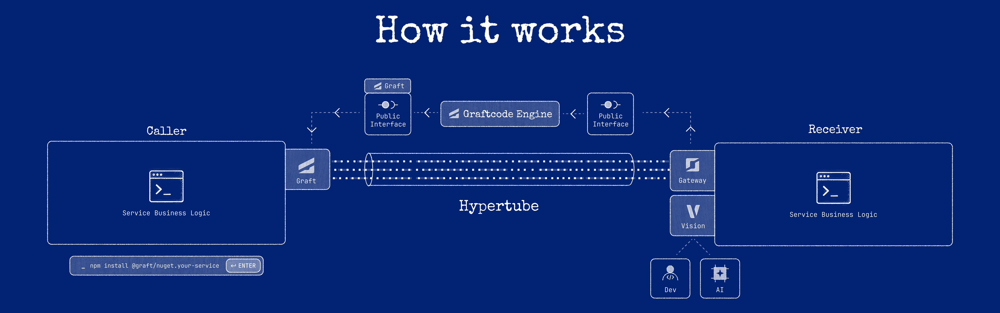

# Invocation lifecycle

1. **Application code calls a generated member.** Static and instance members use different generated handlers.
2. **The generated `GraftConfig` initializes once.** It loads known environment and file sources, registers the generated default, and initializes a named runtime context.
3. **Configuration resolution selects connection data.** The winning source determines in-memory, WebSocket, HTTP/2, TCP, or plugin behavior.
4. **Generated code builds an operation.** Instance operations carry the generated instance context; static operations target the type directly.
5. **Hypertube represents the call for transfer.**
6. **The selected execution mode carries it.** In-memory execution runs the Receiver in the same process; network modes send the call over the configured transport.
7. **The Receiver handles the call.**
8. **The result is returned and converted back to the Caller's types.**

## Failure points

Failures can occur before execution (missing package or invalid configuration), during connection/transport, during dispatch, in user implementation code, or while mapping a response. Remote calls therefore require normal distributed-systems handling even though the call site resembles ordinary code.

## Async, cancellation, and timeouts

Remote graft calls look like local methods, but async behavior splits into **two layers**. Confusing
them is a common source of outdated assumptions (for example that a .NET Receiver must expose only
synchronous methods, or that only Node.js Callers get an async API).

### Two layers

| Layer | What it means |
| --- | --- |
| **Receiver (callee)** | Native async (`Task`, `Promise`, `async def`, …) is **completed on the Receiver** before the result is serialized. Live `Task`/`Promise` handles are **not** transferred over the graft wire. |
| **Caller (generated Graft + Hypertube SDK)** | Each invocation uses synchronous **`execute()`** / **`Execute()`** or parallel **`execute_async()`** / **`ExecuteAsync()`** on the Hypertube `InvocationContext` chain. Parallel async RPC does not require the Receiver method to be `async`. |

Hypertube does not expose a consumer model based on polling `GetAsyncOperationResult` (protocol command 44) for ordinary Graft usage. Treat each graft call as **one request → one completed result** (or error).

Also keep these distinct:

- **Receiver internals** can use async code freely behind a public method.
- **Receiver public contract:** native async return types (`Task`/`Task<T>`, `Promise`, `async def`, …) are supported as **completed results** on the Receiver side. They are **not** live handles over the wire. **`CancellationToken`** and similar cancellation parameters are not a portable public contract—keep them internal.
- **Generated Caller API:** shape depends on the Caller runtime and UGM completion metadata (`METHOD_COMPLETION`). You may see `Task`/`Promise`/coroutines, `ExecuteAsync`/`execute_async`, or deferred wrappers for synchronous RPC across .NET, Node.js, Python, Ruby, PHP, and JVM. Follow the installed package and Vision, not a single-runtime example.
- **Parallel calls:** the same Receiver method can be invoked with `execute_async()` / `ExecuteAsync()` to run multiple RPCs concurrently; that is a Caller/Hypertube choice, not a change to the Receiver signature.
- **Cancellation and timeouts** are a Caller/deployment concern. There is no built-in cross-runtime cancellation; apply timeouts, retries, and cancellation in Caller code and infrastructure. See [Timeouts and retries](../operations/timeouts-and-retries.md).

### Completion metadata (`METHOD_COMPLETION`)

During analysis, Graftcode can attach **`METHOD_COMPLETION`** to a method in the Unified Graft Model
(UGM) with two flags:

| Flag | Meaning |
| --- | --- |
| **`IS_ASYNC_CALL`** | The source method is an async RPC shape (for example .NET `async`/`await`, or equivalent in other runtimes). The generated Caller uses async invocation (`ExecuteAsync` / `execute_async`, language `async`/`await` where emitted). |
| **`HAS_DEFERRED_RETURN`** | The source return type is a deferred wrapper (`Task<T>`, `Promise<T>`, `CompletableFuture`, …). The generated Caller exposes a deferred return (for example `Task<T>` on .NET, `Promise<T>` in TypeScript) even when the Hypertube call uses synchronous `execute()`. |

Legacy UGM without `METHOD_COMPLETION` falls back to documented return types in `COMMENT_RETURNS` for
deferred-return detection (return type only, not parameters).

#### Three generated patterns (conceptual)

| Pattern | Typical Receiver | Hypertube call | Generated Caller (examples) |
| --- | --- | --- | --- |
| **Sync** | `int Get()` | `execute()` | Plain return type |
| **Async RPC** | `async Task<int> Get()` | `execute_async()` / `ExecuteAsync()` | `async`/`await` + deferred return where applicable |
| **Deferred sync** | `Task<int> Get()` without `async` | `execute()` | `Task.Run` (.NET), `Thread` (Ruby), `CompletableFuture` (JVM), coroutine wrapper (Python), … |

Always follow the **exact** method signatures and bodies in the installed package and Vision—they
reflect these flags for your Receiver/Caller pair.

### Async limits (unsupported or unsafe)

| Topic | Notes |
| --- | --- |
| **`CancellationToken` / cross-runtime cancellation** | Not a portable public contract; use Caller-side timeouts. |
| **`Task` / `Promise` as RPC arguments** | Do not pass live async handles as parameters. |
| **Streaming live async handles** | Results are flattened after Receiver completion. |
| **Remote vs in-memory** | Network calls still have latency and failure modes. |

`Task` / `ValueTask` / `async` on a .NET Receiver public method use **completed-result** semantics in UGM, separate from [parsable framework types](../reference/type-compatibility-matrix.md#parsable-framework-types) such as `System.DateTime`. See [Known limitations](../reference/known-limitations.md#invocation-and-async).

## What does not happen per call

The module is not re-analyzed and the Graft package is not regenerated during an ordinary invocation. Those belong to the package/build path.
