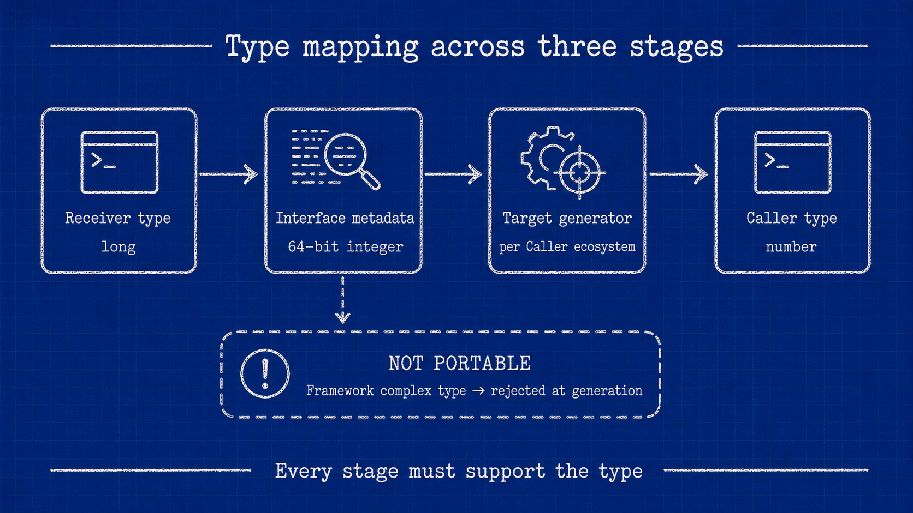

# Type mapping

Type mapping occurs as Graftcode captures the Receiver's callable surface and generates the Caller package. Support is a property of that complete Receiver-to-Caller path—not just the source language.

## Detailed mappings by target language

For generated TypeScript/JSDoc, current primitive mappings include:

- string and char → `string`;
- numeric primitive categories → `number`;
- boolean → `boolean`;
- void → `void`;
- nullable values → a union with `null`;
- Graft model types → generated class names.

For generated .NET, current mappings include:

- string → `string`;
- integer and unsigned integer → `int`;
- boolean → `bool`;
- float → `float`;
- byte → `byte`;
- char → `char`;
- long and unsigned long-long → `long`;
- double → `double`;
- nullable supported value types → `?`;
- Graft model types → generated or known local types.

Unknown values can degrade to `unknown` in TypeScript or `object` in .NET, except where an unresolved local class is recognized.

## Portable baselines for all generated Callers

Graftcode also supports Java/JVM, Python, PHP, and Ruby, with cross-runtime smoke coverage. Their
conservative public-contract baselines are:

- **Java/JVM:** `String`, primitive numbers, `boolean`, plain Java objects, and homogeneous arrays.
- **Python:** `str`, `int`, `float`, `bool`, simply typed classes, and homogeneous `list[T]` values.
- **PHP:** `string`, `int`, `float`, `bool`, typed plain classes, and homogeneous sequential arrays.
- **Ruby:** `String`, `Integer`, `Float`, booleans, small value objects, and homogeneous `Array` values.

These are interoperability baselines, not exhaustive mappings. Boxed and nullable values, unions,
enums, records, generics, maps, framework collection **interfaces**, arbitrary framework classes,
and inheritance require verification for the exact Receiver-Caller pair.

## Parsable framework types

Some framework types are **parsable**: they have a defined cross-runtime mapping (catalog in the
Graftcode protocol). Examples include `System.DateTime`, `System.Guid`, `System.Uri`, selected
`java.time.*` types, and `datetime.datetime`. They are **not** subject to the same opaque
framework `422` rule as types such as `System.Type` or `List<T>` on a .NET public signature.

ISO-8601 **strings** are still the safest default when you need one contract for every Caller.
When you use parsable types, generate the Caller package and run a smoke test for each
Receiver→Caller direction. See [Parsable framework types](../reference/type-compatibility-matrix.md#parsable-framework-types).

## Async and deferred returns

Generated Caller methods may be synchronous, `async`, or return deferred types (`Task`, `Promise`,
coroutines) based on Receiver signatures and UGM completion metadata—not only on whether the
Receiver method was written with `async`. Parallel Hypertube invocation uses `execute_async()` /
`ExecuteAsync()` where emitted. See [Invocation lifecycle](invocation-lifecycle.md#async-cancellation-and-timeouts).

## Runtime support and per-runtime notes

- [Supported runtimes and package managers](../reference/supported-runtimes-and-package-managers.md) — which runtimes host Receiver code and act as Caller.
- [Runtime-specific notes](../reference/known-limitations.md#runtime-specific-notes) — per-runtime type and contract caveats.

Perl and Python 2.7 have no generated-package or type-mapping path.

## Supported surface is stricter than discovery

Graftcode rejects many **non-parsable library and framework types** on the public surface—for example
`List<T>` instead of an array, `Stream`, or arbitrary BCL classes. Requesting the Caller package
then fails with HTTP `422`. A type listed in Vision or Gateway therefore does not guarantee that
Callers can install or use a generated package.

Use simple primitives, plain models, language arrays, parsable types (when tested), or string
encodings for dates and IDs.

## Collections, generics, callbacks, and nullability

Graftcode handles arrays (including `byte[]` / `bytes` buffers), generics, delegates, nested types, and nullable metadata, but support varies by language pair. Verify each intended language pair with a generated-package smoke test.

This is not a complete compatibility matrix. Confirm richer types for the exact Receiver/Caller pair before relying on them.
