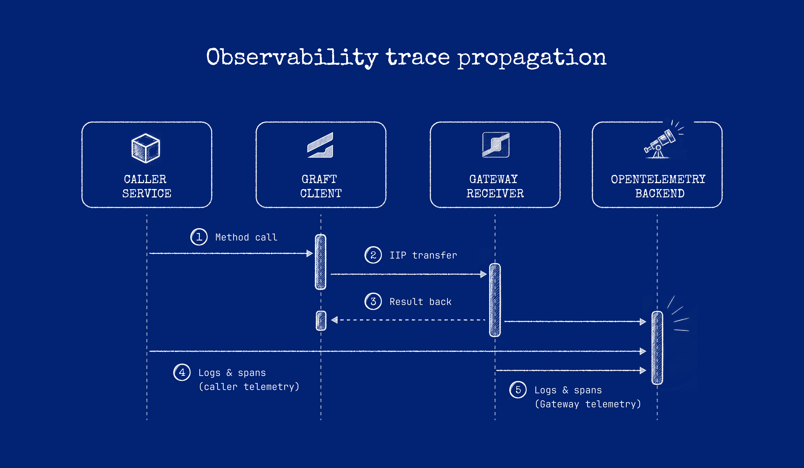

# Logging, metrics, and tracing

## Logging

Capture Gateway standard output/error and Receiver logs with instance, release, module, and runtime
labels. Log startup discovery and publication separately from invocation failures.

### Runtime SDK structured logging and redaction

The runtime SDKs (.NET, Java/JVM, Node.js/TypeScript, Python, and Ruby) include a structured logger
that formats console output as `[Graftcode:<Level>] operationId=- parentSpanId=- <message>` and
supports attaching log listeners for external log bridges.

Configure SDK logging with environment variables:

- `HYPERTUBE_LOG_LEVEL` — minimum console log level: `Debug`, `Info`, `Warning` (default when debug is off), `Error`, or `Off`.
- `HYPERTUBE_LOG_ASYNC` — `true` (default) or `false` to control asynchronous background log flushing.
- `HYPERTUBE_LOG_QUEUE_CAPACITY` — maximum buffered log entries (default `16384`, minimum `256`).

Structured log properties and message templates automatically redact sensitive keys and values (such
as `Authorization` headers, Bearer tokens, JWTs, passwords, and connection strings) as `[REDACTED]`,
while preserving `traceparent` and `traceid` for trace correlation.

### Protocol byte debugging

`GG_DEBUG=1` or `TRUE` (on Gateway) and `HYPERTUBE_DEBUG=true` (on the SDK) log incoming and outgoing
protocol traffic. Use them only for controlled diagnosis; raw payload bytes can expose sensitive data
and increase log volume.

## Tracing



Graftcode propagates W3C Trace Context (`traceparent`, `tracestate`) and custom correlation headers
across Graft calls so a remote call joins the Caller's active trace instead of starting a new one.

Trace propagation is supported across **all six supported runtimes** (.NET, Node.js/TypeScript,
Java/JVM, Python, PHP, and Ruby):

- **Per-call and global headers (all 6 runtimes):** Pass `traceparent` or correlation IDs from the
  Caller using `GraftConfig.InvokeWithHeaders` / `InvokeWithHeadersAsync` (or `GraftConfig.SetHeaders`)
  and read them on the Receiver through `RequestContext` in [Graftcode Context](../core-concepts/graftcode-context.md).
  Gateway automatically detects `graftcode-context` when the hosted module provides it.
- **Runtime pipeline hooks (.NET, Node.js/TypeScript, Java/JVM, Python, and Ruby):** Attach an
  invocation/handling listener to `HypertubeBroker` (`Attach` / `attach`) to inject `traceparent` into
  outgoing call headers before execution and extract it on the Receiver before handling, without
  wrapping individual call sites.
- **HTTP/2 transport auto-instrumentation:** When calling over HTTP/2 (`https://.../h2`), standard
  OpenTelemetry HTTP/`fetch` instrumentation can inject `traceparent` headers on the transport
  request, which Gateway forwards into the Receiver's `RequestContext`.

Trace export is an application or platform responsibility. Instrument the Caller and Receiver with
their normal OpenTelemetry setup and exporter; Gateway does not provide a built-in collector.

### End-to-end trace flow

1. **Configure OpenTelemetry in the Caller** with your exporter (for example OTLP to Jaeger, Grafana
   Tempo, or Azure Monitor) and start a span around the operation that calls the Graft.
2. **Propagate `traceparent` on the Graft call** via `GraftConfig.InvokeWithHeaders` (all runtimes)
   or a `HypertubeBroker` pipeline listener (.NET, Node.js, JVM, Python, Ruby).
3. **Extract context in the Receiver** from `RequestContext` (or the `HypertubeBroker` handling hook)
   using your OpenTelemetry propagator and start a child server span.
4. **Export to one backend.** In the trace backend you see the Caller span, the Receiver span, and any
   nested calls under one shared trace ID:

```text
trace 4bf92f3577b34da6...
  └─ Caller span: CalculateMonthlyBill (client)
       └─ Receiver span: BillingService.CalculateMonthlyBill (server)
            └─ Receiver span: repository.load (internal)
```

Record errors on the active span in the Receiver so failures appear on the same trace. Nested Graft
calls from the Receiver continue propagating context in the same way.

## Metrics

Record at the Caller/Receiver boundary:

- call count and failures by stable operation name;
- duration distributions;
- active/failed connections;
- process CPU, memory, restarts, and instance count;
- dependency timeout/retry counts.

Avoid IDs, argument values, and unbounded exception text as metric labels.

Gateway exposes `GET /status` (`200 OK`) for liveness checks, but does not expose a built-in
Prometheus/OpenMetrics endpoint or metric collector. Instrument your applications and infrastructure
to collect metrics.

## Next steps

- [Graftcode Context](../core-concepts/graftcode-context.md)
- [Handle Receiver errors](../how-to-guides/handle-receiver-errors.md)
- [Timeouts and retries](timeouts-and-retries.md)
- [Environment variables](../reference/environment-variable-reference.md)
