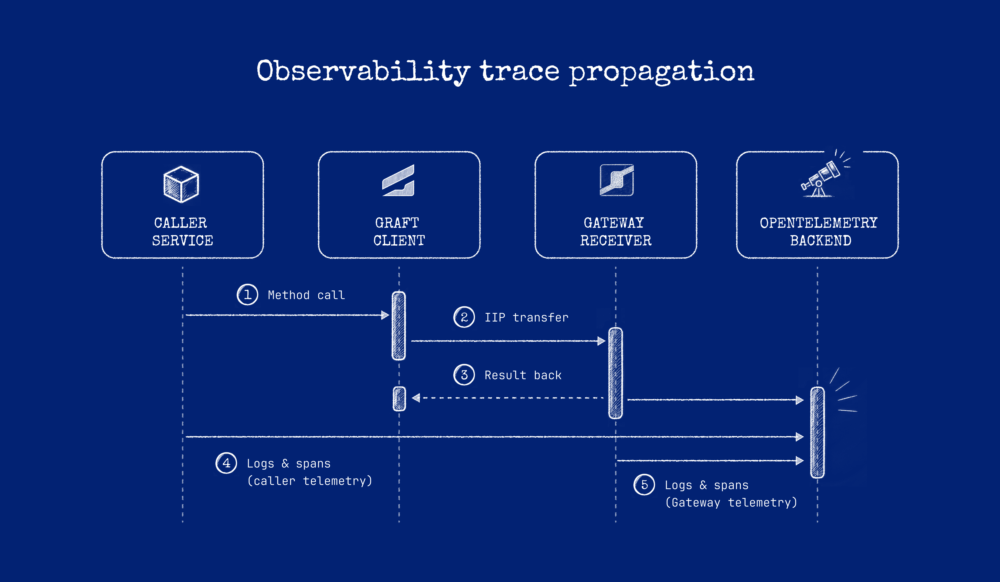

# Logging, metrics, and tracing

## Logging

Capture Gateway standard output/error and Receiver logs with instance, release, module, and runtime
labels. Log startup discovery and publication separately from invocation failures.

`GG_DEBUG=1` or `TRUE` logs incoming and outgoing byte traffic. Use it only for controlled diagnosis;
payload bytes can expose sensitive data and increase log volume.

## Tracing



Graftcode propagates W3C Trace Context (`traceparent`) across a Graft call on **.NET and Node.js**, so
a single remote call joins the Caller's trace instead of starting a new one. Other runtimes are not
guaranteed to propagate context; verify before relying on it.

Trace export is yours. Gateway does not ship a collector. On .NET, the `Hypertube.Instrumentation`
package creates the spans and, by default, writes `traceparent` onto the call. You subscribe to the
`Graftcode` activity source and send spans and logs with the exporter you already use (OTLP, Azure
Monitor, or another OpenTelemetry exporter).

### What a Graft call looks like

Each call produces two spans under one trace id:

- **Caller span**, named `Graft` plus the target. The target is the loaded library, its version when
  known, and the channel (`inmemory`, `tcp`, `http2`, `websocket`). With no library it is the runtime
  name and the channel, for example `Graft Netcore inmemory`.
- **Receiver span**, named after the operation, such as `BillingService.CalculateMonthlyBill`. It is a
  child of the Caller span when `traceparent` arrives with the call.

The Caller span carries the dependency details: `hypertube.runtime`, `hypertube.command_type`,
`hypertube.connection_type`, `hypertube.operation`, `hypertube.target`, `graft.dependency.type`
(`Graft`), and `graft.dependency.target`. The Receiver span is the operation itself and does not
repeat those dependency attributes. A .NET exception on the call sets the span status to error.
Nested Graft calls from the Receiver keep the same trace on the supported runtimes.

```text
trace 4bf92f3577b34da6...
  └─ Caller span: CalculateMonthlyBill
       └─ Graft billing 1.2.0 http2
            └─ BillingService.CalculateMonthlyBill
                 └─ repository.load
```

Hypertube log lines follow the span that is active while the call runs. Pass an `ILogger` into the
registration below and the lines go to that logger, so your log exporter correlates them with the
trace. OpenTelemetry and Azure Monitor do this when the log is written during the call. Leave the
logger out and the same lines are events on the span; they then export with the trace and follow
that span's sampling decision.

Request and response bodies are not recorded unless you turn capture on. See
[Environment variables](../reference/environment-variable-reference.md).

### .NET without a generic host

Use this on a Receiver whose startup class only configures the process, and on any other .NET
process that does not run `IHost`. Graftcode Gateway does not keep a .NET message loop after that
class returns; the process stays up in native code. Create the providers once, store them in static
fields, and leave them until the process exits. Do not dispose them from a finalizer, and do not
call a Hypertube start or stop method.

`AddHypertubeInstrumentation` subscribes the builder to the `Graftcode` source and attaches
Hypertube for as long as the `TracerProvider` lives.

```csharp
using Microsoft.Extensions.Logging;
using OpenTelemetry;
using OpenTelemetry.Logs;
using OpenTelemetry.Trace;

public sealed class Startup
{
    private static readonly ILoggerFactory Logs = LoggerFactory.Create(logging =>
    {
        logging.AddOpenTelemetry(options =>
        {
            options.IncludeFormattedMessage = true;
            options.AddOtlpExporter();
        });
    });

    private static readonly TracerProvider Traces = Sdk.CreateTracerProviderBuilder()
        .AddHypertubeInstrumentation(Logs.CreateLogger("Hypertube"))
        .AddOtlpExporter()
        .Build();
}
```

Omit the logger argument when the lines should stay on the span:

```csharp
private static readonly TracerProvider Traces = Sdk.CreateTracerProviderBuilder()
    .AddHypertubeInstrumentation()
    .AddOtlpExporter()
    .Build();
```

Call the Graft as usual. A span you already started around that call becomes the parent; Graftcode
adds `traceparent` to the outgoing invocation.

### .NET with a generic host

ASP.NET Core and a worker that already calls `host.Run()` start hosted services for you. Register
the source and the Hypertube hook next to the rest of OpenTelemetry. The host attaches
instrumentation at startup and detaches it at shutdown, and it forwards Hypertube logs to the host
`ILogger`.

```csharp
builder.Services.AddOpenTelemetry()
    .WithTracing(tracing => tracing
        .AddSource("Graftcode")
        .AddOtlpExporter())
    .WithLogging(logging => logging.AddOtlpExporter());

builder.Services.AddHypertubeInstrumentation();
```

That is the only Hypertube registration. The application's existing `Run` or `Start` is what starts
it.

### Propagation

Auto-inject is on unless `HYPERTUBE_TELEMETRY_AUTO_INJECT` is `false` or `0`. Set that variable
before the process creates its first Hypertube span; the flag is read once.

`traceparent`, `tracestate`, and `traceid` travel with the call and do not require
`Graftcode.Context.RequestContext`. On HTTP/2 they are request headers. On WebSocket they are sent
with the handshake. On in-memory and TCP they ride in the command metadata, and the Receiver reads
them from that metadata before it runs the method. Any other context header still needs
`Graftcode.Context.RequestContext` on the Receiver. If such a header is present and that type is not
loaded, the call fails.

### Node.js

Node.js propagates `traceparent` as well. Configure the Caller and the Receiver with their normal
OpenTelemetry tracer, W3C propagator, and exporter. The `Hypertube.Instrumentation` registration
above is the .NET package.

## Metrics

Record at the caller/Receiver boundary:

- call count and failures by stable operation name;
- duration distributions;
- active/failed connections;
- process CPU, memory, restarts, and instance count;
- dependency timeout/retry counts.

Avoid IDs, argument values, and unbounded exception text as metric labels.

Gateway does not expose a built-in Prometheus/OpenMetrics endpoint or a metric catalog. Instrument
your applications and infrastructure to collect metrics.

## Next steps

- [Handle Receiver errors](../how-to-guides/handle-receiver-errors.md)
- [Timeouts and retries](timeouts-and-retries.md)
- [Environment variables](../reference/environment-variable-reference.md)
